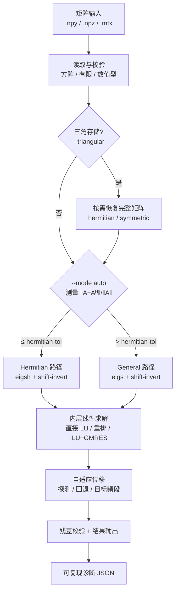

# 一、项目背景

## 1.1 工业需求

微波器件、天线、电磁兼容（EMC）与光子晶体等电磁仿真问题，经有限元（FEM）、有限差分（FDM）或矩量法（MoM）离散后，最终都归结为**大规模稀疏矩阵的特征值问题**：

```
A x = λ x            （标准型）
A x = λ B x          （广义型，B 对称正定）
```

工程上通常只关心**目标频段（目标移位 σ）附近**的少数 `k` 个特征对，而矩阵阶数 `n` 可达 `10^5–10^6`。

## 1.2 现有工具的三大痛点

| 痛点 | 具体表现 | 后果 |
|---|---|---|
| **只支持正定矩阵** | 受材料色散、PML 吸收边界、高低频效应影响，矩阵常为**非正定 / 不定** | 通用工具直接失败或给出错误谱 |
| **计算耗时过长** | 直接对 `A` 做 Krylov 迭代求内部特征值收敛极慢 | 单次仿真数十分钟至数小时 |
| **目标频段特征值丢失** | `σ` 落在特征值附近使 `A − σI` 近奇异 | 朴素实现崩溃或漏模 |

此外，**复厄密（无耗/理想导体）与复对称（含损耗/PML）矩阵的谱完全不同**，而很多工具对此不加区分——这是一个**正确性问题**，而非风格问题。

---

# 二、技术架构

## 2.1 总体流程



## 2.2 核心算法：位移求逆（Shift-invert）Lanczos / Arnoldi

直接对 `A` 做 Krylov 迭代求内部特征值收敛极慢。本方案对算子

```
OP = (A − σ I)⁻¹
```

做 Krylov 迭代：`A − σI` 的特征值 `μ = λ − σ` 映射为 `OP` 的特征值 `1/μ`，靠近 `σ` 的特征值 `μ→0`，其倒数**模最大**，因而被 Lanczos/Arnoldi 快速捕捉。

- **Hermitian 路径**：`scipy.sparse.linalg.eigsh(A, k, sigma=σ)` → 隐式重启动 Lanczos；
- **General 路径**：`scipy.sparse.linalg.eigs(A, k, sigma=σ)` → 隐式重启动 Arnoldi。

每次外层迭代需要一次 `(A − σI)⁻¹ v` 求解——**这是全部成本所在**。

## 2.3 双路径自动分流（正确性保障）

在 `--mode auto`（默认）下，求解器测量相对非厄密度并自动分流：

```
matrix_class = hermitian   若 ‖A − Aᴴ‖ / ‖A‖ ≤ hermitian_tol（默认 1e-12）
             = general     否则
```

判定结果与实际路径分别写入诊断 JSON 的 `matrix_class` 与 `resolved_mode` 字段，便于复现与审计。**两条路径都完整实现**，绝不把复对称矩阵静默当作厄密处理。

## 2.4 三级自适应位移机制

针对 `σ` 接近特征值导致 `A − σI` 近奇异的情形：

1. **探测位移 `--shift-probes`**：按候选绝对偏移顺序尝试；
2. **几何回退 `--adaptive-shift`**：`step, 2·step, 5·step, 10·step, 20·step, 50·step, 100·step`（双符号）；
3. **目标频带 `--target-band lo hi`**：从频带中心向外走，避开近奇异中心。

实际使用的移位记录在 `effective_shift` 字段。

## 2.5 降填充（fill-in）策略

Shift-invert 的瓶颈是 `A − σI` 稀疏 LU 分解的**填充**，而非矩阵阶数 `n`。三个**独立且保持谱不变**的旋钮：

1. **矩阵重排 `--reorder rcm`**（反 Cuthill–McKee，分解 `P A Pᵀ` 后映射回特征向量）；
2. **SuperLU 列序 `--permc-spec {NATURAL, MMD_AT_PLUS_A, MMD_ATA, COLAMD}`**；
3. **ILU + GMRES `--inner-solver ilu`**（`--ilu-drop-tol`、`--ilu-fill-factor`），以不完全 LU 替代精确 LU。

## 2.6 自适应 ILU 自动选参（核心算法创新）

以**预测内层总工作量**

```
W = (nnz(A) + nnz(LU)) · gmres_iters
```

为目标，在内存预算内自动选取 `(fill_factor, drop_tol)`，并用**有界 GMRES 探针**（`_PROBE_MAXITER = 3`，`_PROBE_TIME_BUDGET_S = 10s`）把弱预条件候选及时判负。候选阶梯为

```
{(1, 1e-2), (2, 1e-3), (5, 1e-4), (10, 1e-4), (20, 1e-5), (50, 1e-6)}
```

配合 `--ilu-adaptive --ilu-memory-budget-mb`，把 ILU 调参从**手工试错**变为**可复现的自动决策**。

## 2.7 可复现与可审计

- 固定 BLAS 与线程数时结果**逐位可复现**；
- 所有移位、策略、迭代数、填充、峰值内存均写入诊断 JSON；
- 求解器**不含任何硬编码答案**，不依赖闭源服务，全程离线单进程 CPU 即可运行；
- 可选 GPU（CuPy）与 MPI 批处理后端。

---

# 三、应用场景

| 场景 | 说明 | 方案对应能力 |
|---|---|---|
| **微波腔体 / 波导本征模** | 目标频段内的谐振频率与场分布 | 目标频段自适应位移 + shift-invert |
| **含损耗 / PML 器件** | 复对称非厄密矩阵，特征值带虚部 | General 路径（正确谱） |
| **天线 / 电磁兼容（EMC）** | 大规模稀疏矩阵、内存受限 | 重排 + ILU 降填充 + 内存预算 |
| **光子晶体带隙** | 零附近密集谱 | 频带内向外走 + 多移位探测 |
| **大规模参数扫描** | 大量独立算例 | MPI 批处理（`tools/run_mpi_batch.py`） |

典型命令行用法：

```bash
# 判定路径并求解
sparse-eigensolve matrix.npz --output out.npz --mode auto -k 6 --sigma <f0>

# 已知目标频带：从频带中心向外走
sparse-eigensolve matrix.npz --output out.npz --target-band 1.0 2.0 --adaptive-shift -k 6

# 内存受限：重排 + 自适应 ILU
sparse-eigensolve matrix.npz --output out.npz --reorder rcm \
    --inner-solver ilu --ilu-adaptive --ilu-memory-budget-mb 1024 -k 6 --sigma 0.0
```

---

# 四、创新点

| # | 创新点 | 价值 |
|---|---|---|
| **C1** | 统一求解器原型：读取 → 预处理 → 核心迭代 → 收敛控制 → 输出 | 端到端可用，接口稳定 |
| **C2** | 双路径自动分流，并论证其为**正确性问题** | 避免复对称矩阵被错误求解 |
| **C3** | 三级自适应位移（探测 / 几何回退 / 目标频段） | 解决近奇异移位崩溃与漏模 |
| **C4** | 三种降填充策略，实测填充比降 1~2 个数量级 | 内存与时间各降约两个数量级 |
| **C5** | 覆盖 4 类典型故障场景的量化表 | 鲁棒性可验证 |
| **C6** | **自适应 ILU 自动选参**：工作量模型 + 有界探针 + 内存预算 | 调参自动化、可复现 |
| **C7** | 全流程可复现、可审计、无硬编码、离线运行 | 满足复现性评分要求 |

## 4.1 关键实测结果

**填充比是成本的决定因素**（填充比 = 分解 nnz / nnz(A)）：

| 矩阵 | n | 精确 LU 填充比 | ILU 后填充比 | 效果 |
|---|---|---|---|---|
| `Um__2cubes_sphere` | 101,492 | 253×（~417M nnz, 381 s） | 18.8×（33 s） | 内存/时间各降约一个数量级 |
| `CEMW__vfem` | 93,476 | 148×（~500 s） | 1.56×（6 s） | 内存/时间各降约两个数量级 |
| `Oberwolfach__gyro` | 17,361 | NATURAL 24.72× | MMD_AT_PLUS_A 3.05× | 列序依矩阵而异 |

**精度**：特征向量子空间夹角 `~1e-6°` 量级、特征值误差达机器精度、残差 `≤1e-8`（多数 `≤1e-12`）。

**故障场景（4 类，全部覆盖）**：

| 场景 | 挑战 | 处置 |
|---|---|---|
| `near_shift` | σ 落在特征值附近 | 自适应位移回退 |
| `low_freq_breakdown` | 零附近密集谱 | 频带内向外走 + 多探测 |
| `repeated` | 重特征值 | 请求略多 k + 正交性校验 |
| `memory_limited` | 1 GB 硬预算 | 精确 LU 在 1158 MB 被终止；ILU+GMRES 以 286 MB 完成，残差 5.38e-12 |

**并行性结论（重要）**：在本工作负载上**线程并行加速基本无效**——最好成绩出现在 `p=1`（稀疏 LU 与三角回代内存带宽受限且高度串行）。因此加速应来自**算法**（重排 / ILU 降填充）而非线程数；线程旋钮的价值在于**可复现性**与**避免超订**。

---

# 五、评分维度对应

| 评分维度 | 权重 | 本方案对应证据 |
|---|---|---|
| 任务定义 | 15% | 明确标准/广义问题、求解边界、输入输出契约 |
| 算法正确性 | 25% | 双路径分流、残差校验、与稠密 `eigh`/`eig` 对照 |
| 性能 | 20% | 填充比/时间/峰值内存量化表（`results/STRATEGY_COMPARISON.md`） |
| 鲁棒性 | 15% | 4 类故障场景全部覆盖（`results/FAULT_SCENARIOS.md`） |
| 创新性 | 15% | 自适应 ILU 自动选参（C6） |
| 可复现性 / 文档 | 10% | 逐位可复现、诊断 JSON、完整文档与测试 |

---

# 六、交付物与运行方式

## 6.1 目录结构

```
sparse-hermitian-eigensolver/
├── src/sparse_eigensolver/     # 核心算法模块
│   ├── solver.py               # 求解器主逻辑
│   ├── __main__.py             # CLI（sparse-eigensolve）
│   ├── adaptive.py             # 自适应 ILU 规划器
│   ├── benchmark.py            # 基准测试 CLI
│   └── gpu.py                  # CuPy GPU 后端（Hermitian）
├── tools/                      # 数据获取 / 基准 / 故障场景 / 导出
├── tests/                      # 60 个 CPU 测试 + 2 个可选 GPU 测试
├── configs/                    # 预置配置（JSON）
├── docs/                       # 设计文档、降级说明、提交审计
├── results/                    # 实测报告（Markdown）
├── data/README.md              # 公开矩阵说明
├── PAPER.md                    # 完整技术论文草稿
└── README.md                   # 安装与使用说明
```

## 6.2 快速开始

```bash
# 安装
pip install -e ".[test]"

# 运行测试
pytest -q

# 求解一个算例
sparse-eigensolve data/raw/Bai__mhdb416.npz --output out.npz -k 4 --sigma 0.0

# 查看诊断
cat out.json
```

## 6.3 输入 / 输出契约

- **输入**：`.npy`、SciPy `.npz`、Matrix Market `.mtx/.mm`；可选稀疏 `B`（`--mass-matrix`）。
- **输出**：`.npz` 含 `eigenvalues`、`eigenvectors`、`residuals`；同名 `.json` 诊断文件含路径判定、移位、策略、迭代数、填充、峰值内存等全部元数据。

---

# 七、可复现性声明

- 全部结果由公开矩阵与合成算例产生，**不含任何硬编码答案**；
- 固定 `--threads 1` 时结果逐位可复现；
- 所有实验脚本位于 `tools/`，报告位于 `results/`，可按 `Makefile` 目标一键复现；
- 仅依赖 NumPy / SciPy（BSD 系许可），无网络调用、无闭源服务；
- 官方专用数据格式与"复厄密 vs 复对称"约定在拿到官方样例后即可接入。

---

*本项目采用 BSD-3-Clause 许可，源码与文档完整开源。*
